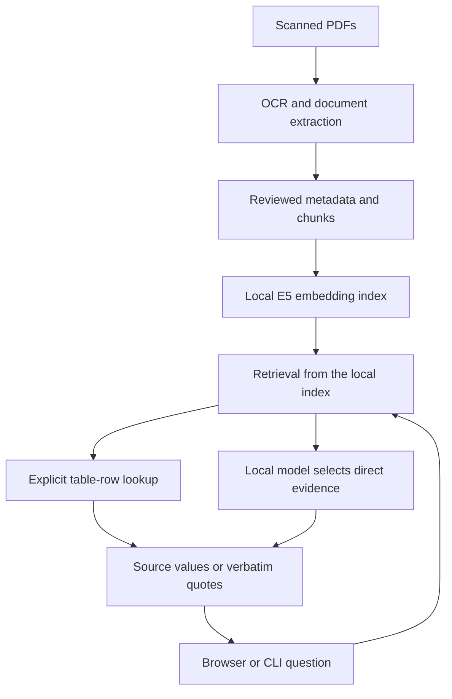

# Home RAG

**Ask questions about scanned documents, inspect the evidence, and keep the entire workflow local.**

Home RAG is a local document question-answering project built around scanned books and publications. It connects OCR and document structure processing to multilingual retrieval, evidence selection with a local model, deterministic table answers, and a browser interface with exact source quotes.

The current default is **evidence-first**: text answers reproduce selected source passages; supported table answers preserve the original column names and cell values. The model does not write a final free-form synthesis in this mode.

## Try the interface

From the repository root, with **Python 3.11+ on macOS or Linux**:

```bash
python3 scripts/serve_ui.py --demo
```

Open [http://127.0.0.1:8765](http://127.0.0.1:8765). Choose an example and click **Zapytaj**. The interface is in Polish.

This demo needs no Python packages, Docker, model downloads, scans or embeddings. It uses a synthetic document and predefined responses selected by keywords. **It demonstrates the interface and result format, not LLM inference or retrieval quality.** The UI explicitly labels synthetic mode.

| Interface demo | Real local pipeline |
| --- | --- |
| `python3 scripts/serve_ui.py --demo` | `pipenv run python scripts/serve_ui.py` |
| Synthetic content and predefined responses | Your prepared local document index |
| No model or Docker required | Offline embedding container and local Ollama |
| UI walkthrough | Retrieval and evidence-based answers |

## What you can inspect

- A question and its current processing stage.
- Answers with clickable source identifiers.
- PDF-page references, section context, and expandable exact quotes.
- Separate PDF-page numbers and unverified printed-page labels from OCR.
- An explicit refusal when no direct evidence is selected.
- The original answer JSON and local execution logs.
- The last execution restored after a page refresh while the same server is running.

The server runs on loopback and handles one question at a time. Each question is independent; this version does not maintain conversational memory.

## Architecture



The preparation workflow preserves provenance and distinguishes automated extraction from reviewed corrections. Retrieval validates index/report consistency. For explicit table questions, matching row labels are preferred before cosine ranking. For text questions, the model selects evidence IDs and separates direct evidence from context; the program resolves those IDs to original quotes. Unsupported selections are rejected by structural validation, while semantic relevance remains model judged.

**The engineering tradeoff:** the earlier two-stage generator could cite an authentic passage while changing its meaning. Evidence-first removes free-form final synthesis from the default path. It produces longer, less polished answers, but the answer text can be inspected directly against the source. The older two-stage mode remains available for comparison.

## Use your real local index

The implemented development environment uses Python 3.11.11 with Pipenv, Docker, multilingual E5-small embeddings and Ollama with `qwen3.5:4b`.

Real mode requires a prepared index, its `embedding_report.json`, the local embedding model cache and Docker image `home-rag-embedding:0.1.0`. Ollama must be reachable at `http://127.0.0.1:11434` with the requested model installed. The default index directory is `data/pages/sample_book_100_ocr/table_v010`.

A fresh clone can run the interface demo immediately. It does not include the source book, scans, model weights or prepared private index needed for real mode. See the detailed project documents below for the processing stages; the UI does not ingest PDFs itself.

With that environment and index already prepared:

```bash
pipenv run python scripts/serve_ui.py
```

Or ask from the CLI:

```bash
pipenv run python scripts/ask.py "Your question about the indexed document"
```

Use `--index-dir` to select another prepared index inside the project. The UI and CLI default to `evidence-first`; `ask.py --answer-mode two-stage` selects the previous generator. Run each command with `--help` for configuration options.

After local models and images are provisioned, the default query path uses local services. Embedding containers run with network access disabled. Initial dependency/model setup may require downloads.

## Validation and observed results

The backend checkpoint on **2026-10-12** had **145 passing code tests**. Its 15-case regression suite completed with **0 execution errors and 0 lexical-check alerts**. The cases cover text, signatures, lists, table values, paraphrases and out-of-scope refusals.

Manual review found a remaining selection issue: L02 included the correct direct quote plus an extra contextual quote that did not establish the requested classification. Zero lexical alerts therefore does **not** mean perfect evidence selection or general accuracy. The suite is small and was reused during development.

On **2026-10-16**, browser acceptance on the developer's Mac confirmed:

| Real-index scenario | Observed end-to-end time | Acceptance result |
| --- | ---: | --- |
| Table-row answer | 13.8 s | Correct values, column labels and cited row |
| Text answer | 80.4 s | Correct original quote and PDF page |
| Out-of-scope question | 53.0 s | Refusal with no stale sources |

JSON download, restoring a completed execution after refresh, and restoring an execution still in progress were also checked. All three synthetic-demo examples were reviewed in the browser. These times are observations from individual local runs, including startup work, not a model benchmark.

The UI adds eight HTTP/process tests, which passed during development. The combined suite is expected to contain 153 tests; run it on your checkout:

```bash
pipenv run python -m unittest discover -s tests -p 'test_*.py' -v
```

Run the real-model regression suite separately, after preparing the local stack:

```bash
pipenv run python scripts/evaluate_rag.py
```

See the [backend checkpoint](docs/evaluation/evidence_first_2026-10-12.md) and [UI acceptance record](docs/UI_ACCEPTANCE.md) for scope and limitations.

## Current limits

- Evidence selection can include contextual quotes or miss useful passages; exact-quote checks do not prove semantic relevance.
- Verbatim passages can be lengthy, repetitive, and contain adjacent information beyond the requested fact.
- Table-row matching uses a limited heuristic for Polish inflections, not a full language parser.
- The evaluated table coverage is limited. Charts and the remaining unreviewed tables are not validated by this checkpoint.
- OCR can affect text and printed-page labels. PDF-page references remain separately visible.
- The UI does not upload/index documents, open original PDF scans, provide persistent history across server restarts, or serve multiple concurrent users.

## Documentation

| Topic | Document |
| --- | --- |
| UI setup and operation | [README_UI.md](README_UI.md) |
| Repository walkthrough | [GitHub demo guide](docs/GITHUB_DEMO.md) |
| UI acceptance | [UI_ACCEPTANCE.md](docs/UI_ACCEPTANCE.md) |
| Query orchestration | [README_ask.md](README_ask.md) |
| Evidence-first answers | [README_evidence_first.md](README_evidence_first.md) |
| Regression evaluation | [README_evaluation.md](README_evaluation.md) |
| Table review and corrections | [README_table_reviews.md](README_table_reviews.md) |
| Printed-page metadata | [README_page_metadata.md](README_page_metadata.md) |

The numbered and fix-specific README files preserve implementation notes from earlier iterations. This main README describes the current default workflow.

Generated execution files live under `data/runs/` and evaluation outputs under `data/evaluations/`. Keep private source documents and generated run data out of the public repository. The synthetic interface demo provides a shareable walkthrough without distributing the source book.
