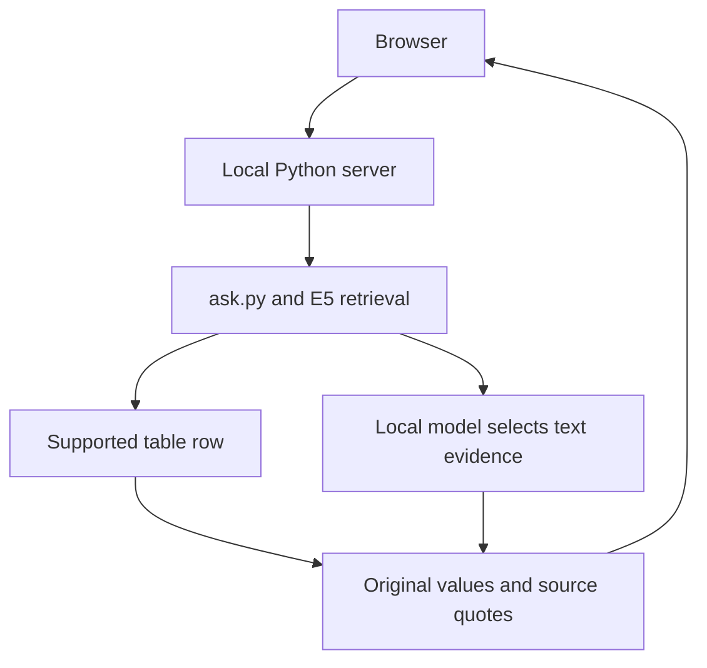

# Home RAG — local document Q&A

A local interface for an evidence-first document question-answering pipeline. Ask a question, inspect the answer, open the cited PDF-page references and quotes, and download the original answer JSON.

## Try the interface in one command

Requires Python 3.11 or later. From the repository root:

```bash
python3 scripts/serve_ui.py --demo
```

Open http://127.0.0.1:8765. Click one of the three example buttons, then **Zapytaj**. This mode uses an original, synthetic document about preparing a home archive. It requires no scans, model downloads, Docker or Python packages. The interface is in Polish.

**Demo mode is an interface fixture, not an LLM demonstration.** Its predefined answers are generated by a small keyword-based backend. The DEMO badge and output metadata identify this mode. It demonstrates the interface and result format, not semantic retrieval quality or inference speed.

## Run against a real local index

With the existing Home RAG environment, local model, embedding image and index prepared as described in the project documentation:

```bash
pipenv run python scripts/serve_ui.py
```

The real interface launches the existing CLI, preserving its checks and audit files:



For supported explicit table questions, column names and cell values are assembled without an LLM call. For text, the model selects evidence IDs; the program copies original source quotes into the answer. A lack of direct evidence produces a refusal. Source selection is still model judged and can include extra contextual quotes.

The server binds to 127.0.0.1 and processes one question at a time. It uses only Python's standard library. The browser page uses no CDN, analytics or remote fonts. Each real question produces the same run/assessment/answer audit artifacts as the CLI.

## Evidence and limits

The evidence-first backend checkpoint from 2026-10-12 had 145 passing code tests and 15 evaluation cases completed without execution errors or lexical-check alerts. Manual review identified a remaining extra-context selection in L02. These are results on a small, repeatedly used regression set, not a general accuracy claim. The evaluation mixes text, lists, signatures, table values and out-of-scope refusals.

See [the checkpoint](evaluation/evidence_first_2026-10-12.md) for scope and known limitations, and [the UI instructions](../README_UI.md) for setup and acceptance tests. Eight new UI tests cover HTTP/process integration. Browser acceptance on the developer’s Mac was completed on 2026-10-16: real-index table/text answers, refusal, JSON export, refresh after completion and during processing, plus all three synthetic examples. See the [UI acceptance record](UI_ACCEPTANCE.md) for evidence and untested areas.

This version does not upload or index PDFs from the browser, open original scanned PDF files, maintain a conversation history, or provide a hosted multiuser service. It shows PDF-page numbers and exact quoted evidence. OCR errors and source limitations remain visible.

## A short recording for a repository walkthrough

1. Show the current mode badge before asking a question.
2. Ask for values from a table and expand the cited source.
3. Ask a text question and inspect the verbatim evidence.
4. Ask an unrelated question and show the refusal.
5. Download the JSON to demonstrate auditability.

When recording a real-index example, use a document you can share or create your own source. Demo mode contains only synthetic content and should be labelled as such in the recording. Do not publish private run folders, model weights, embeddings or book scans as part of the UI commit.

To add a future screenshot, save an image of the accepted demo UI to docs/images/home-rag-demo.png and reference it from the main README.
